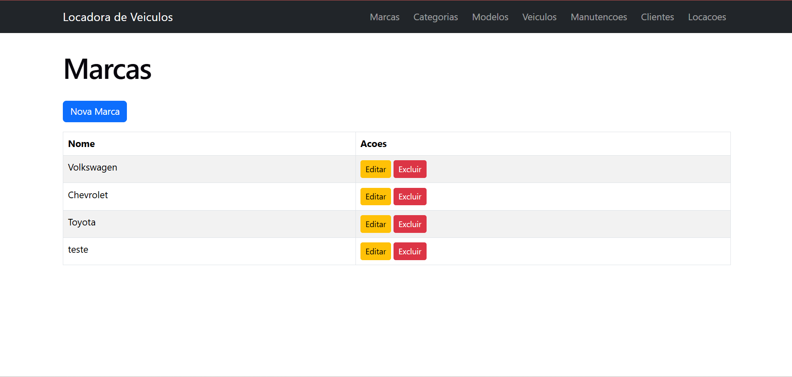
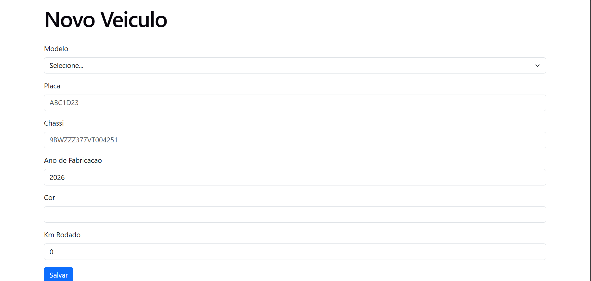
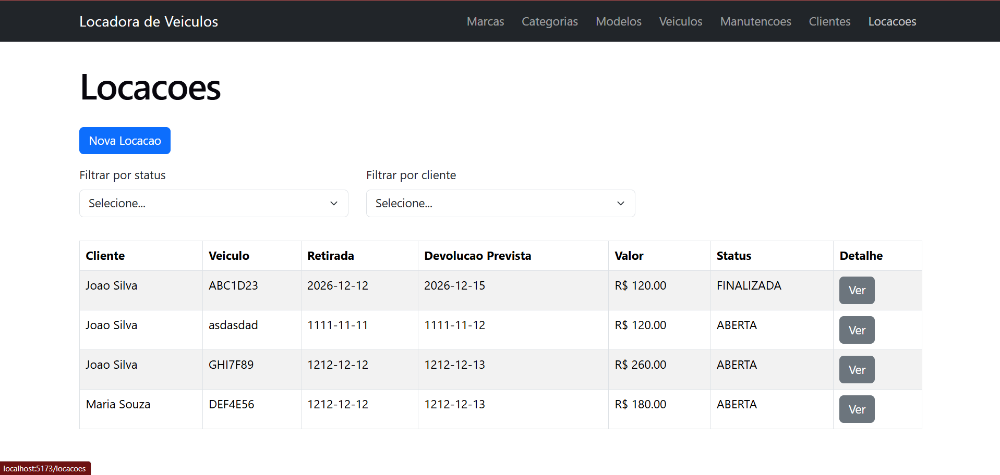
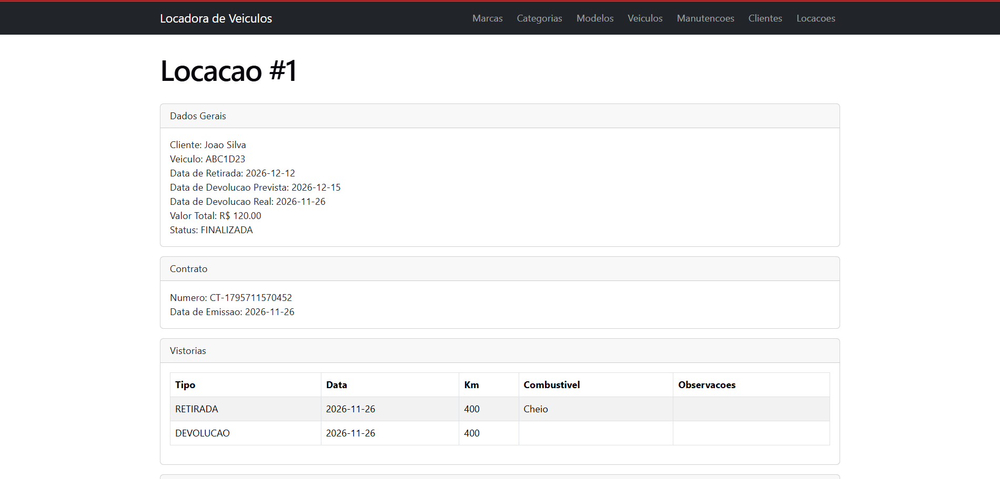
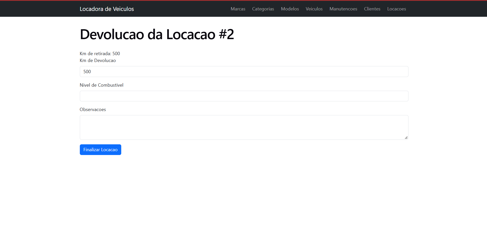

# Locadora de Veiculos

Sistema de gestao de locacao de veiculos desenvolvido como Atividade de Laboratorio (N2).

Permite cadastrar marcas, categorias, modelos, veiculos, manutencoes e clientes, alem de controlar
todo o processo de uma locacao: registro, vistoria de retirada, contrato automatico, pagamentos,
vistoria de devolucao e emissao de nota fiscal.

Aluno: Vitor Faria de Camargo

## Tecnologias

- React + TypeScript (Vite)
- React Router
- Bootstrap
- JSON Server
- Axios

## Estrutura do projeto

```
src/
  components/   componentes reutilizaveis (Button, Input, Select, TextArea, Table, Modal, Alert, Navbar, Card)
  models/       interfaces e tipos de cada entidade
  pages/        telas da aplicacao, uma pasta por entidade
  service/      comunicacao com a API (JSON Server) via Axios
  App.tsx       rotas da aplicacao
  main.tsx      ponto de entrada
db.json         base de dados do JSON Server
```

## Como executar

1. Instalar as dependencias:

```
npm install
```

2. Subir a API (JSON Server), em um terminal:

```
npm run server
```

3. Em outro terminal, subir a aplicacao:

```
npm run dev
```

4. Acessar o endereco mostrado no terminal (geralmente http://localhost:5173).

Os dois comandos (`npm run server` e `npm run dev`) precisam ficar rodando ao mesmo tempo.

## Funcionalidades

- CRUD completo de Marca, Categoria, Modelo, Veiculo, Manutencao e Cliente
- Validacoes: placa/chassi unicos, CPF/CNH unicos, nao exclusao de registros com dependentes
- Registro de locacao com calculo automatico do valor (diarias x valor da categoria)
- Geracao automatica de contrato e vistoria de retirada ao registrar a locacao
- Bloqueio de locacao para veiculo ja locado ou cliente com CNH vencida
- Registro de pagamentos (varios por locacao)
- Devolucao com vistoria, validacao de km e recalculo do valor final
- Emissao de nota fiscal apos a locacao ser finalizada
- Listagem de veiculos com status (disponivel / locado)
- Listagem de locacoes com filtro por status e cliente

## Telas

### Listagem de Marcas


### Cadastro de Veiculo


### Listagem de Locacoes


### Detalhe de uma Locacao


### Devolucao de Locacao

